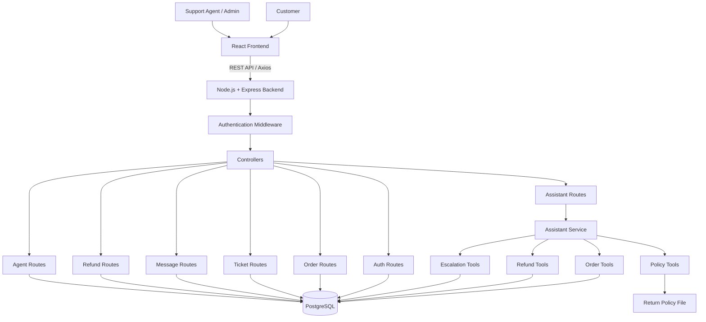

# System Architecture

## Architecture Diagram

## Architecture Explanation

### 1. Frontend
The frontend is developed using React and Vite.

It provides separate interfaces for customers and support agents. Axios communicates with the backend through REST APIs.

### 2. Backend
The backend uses Node.js and Express.js.

It handles:
- API requests and responses.
- Authentication and authorization.
- Customer and agent operations.
- Order, ticket, message and refund management.

### 3. AI Assistant
The assistant uses a rule-based service and backend tools.

Its tools include:
- `get_order_details`
- `search_return_policy`
- `process_refund`
- `escalate_to_human`

### 4. Database
PostgreSQL stores:
- Users
- Orders
- Tickets
- Messages
- Refunds
- Escalations
- Ticket notes
- Audit logs

### 5. Security
JWT authentication and role-based authorization protect private APIs. Refund eligibility and ownership are validated by the backend.

## Request Flow

1. A customer or agent performs an action in the React application.
2. The frontend sends an API request to Express.
3. Authentication middleware verifies the user's JWT.
4. The appropriate controller processes the request.
5. Services perform business logic and interact with PostgreSQL.
6. The backend returns a response to the frontend.
