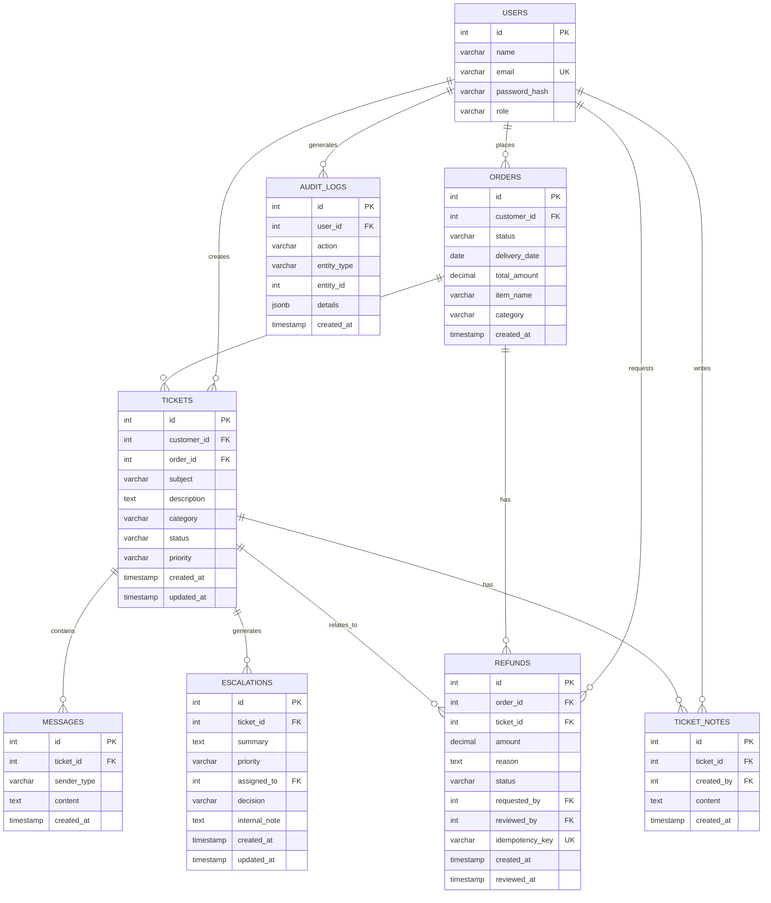

# Database Entity Relationship Diagram (ERD)

## ER Diagram

## Table Descriptions

| Table | Purpose |
|---|---|
| USERS | Stores customer, agent and admin accounts |
| ORDERS | Stores customer order information |
| TICKETS | Stores customer support requests |
| MESSAGES | Stores customer, assistant and agent messages |
| REFUNDS | Stores refund requests and their statuses |
| ESCALATIONS | Stores requests requiring human review |
| TICKET_NOTES | Stores private internal agent notes |
| AUDIT_LOGS | Records important system activities |

## Important Relationships

1. One customer can place multiple orders.
2. One customer can create multiple support tickets.
3. One ticket can contain multiple messages.
4. One order can have multiple associated refund records.
5. One ticket can have multiple escalations and internal notes.
6. Audit logs record important actions performed by users.
